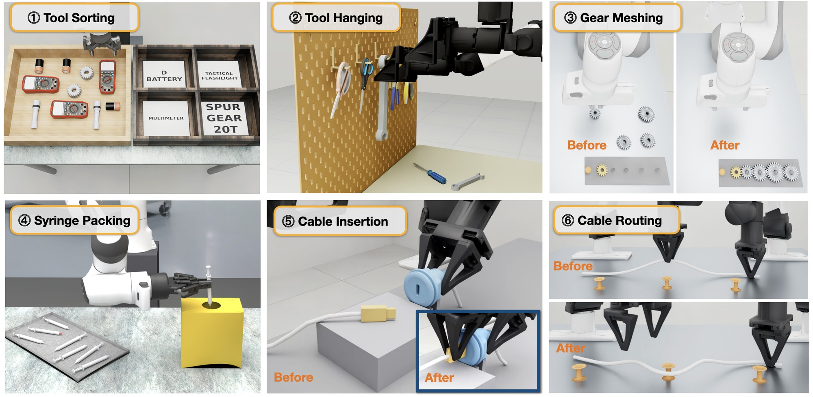
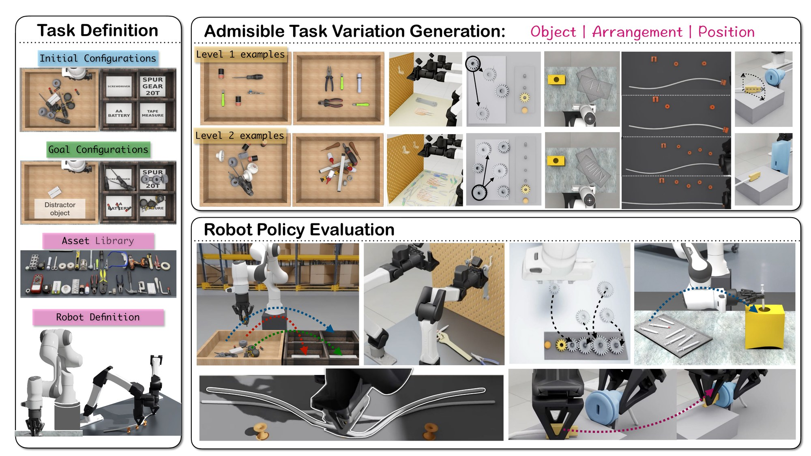
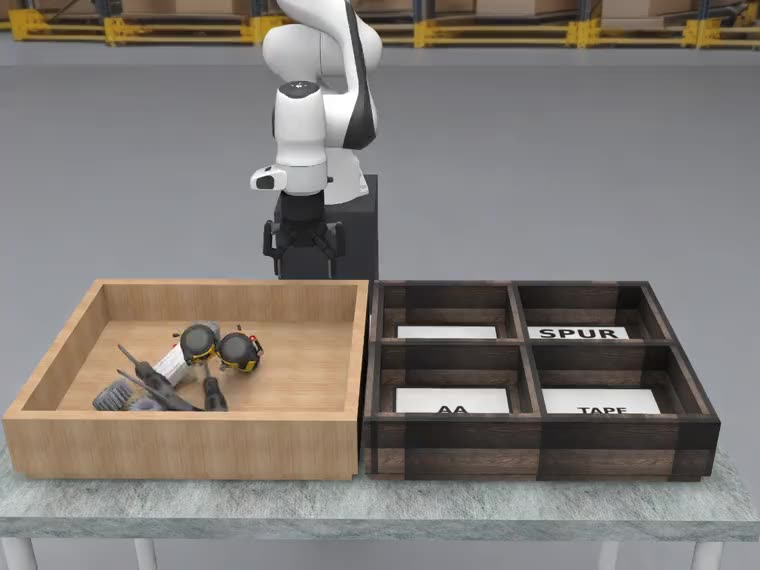
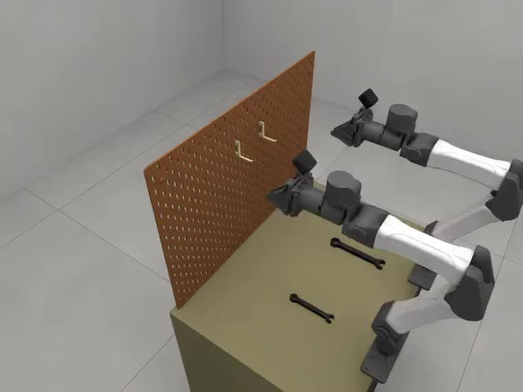
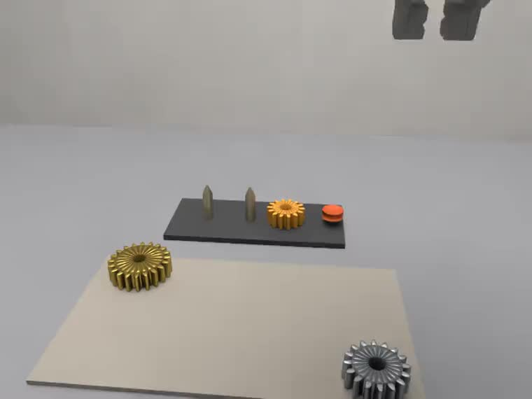
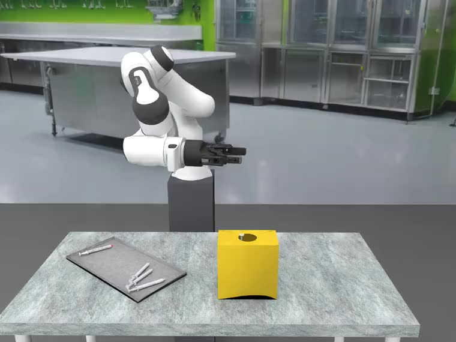
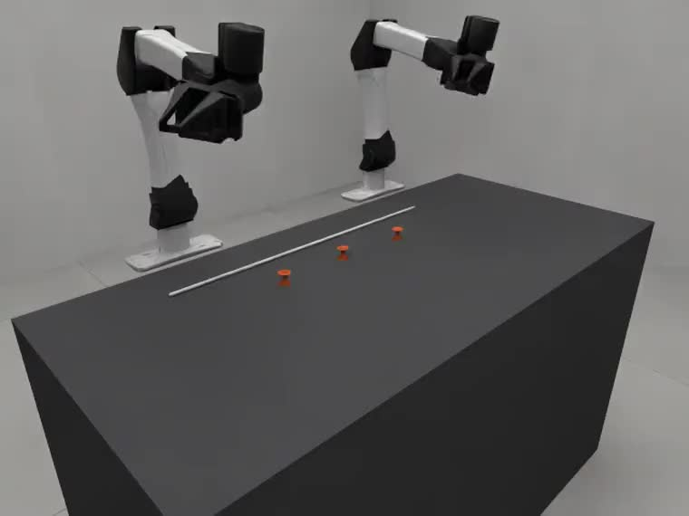
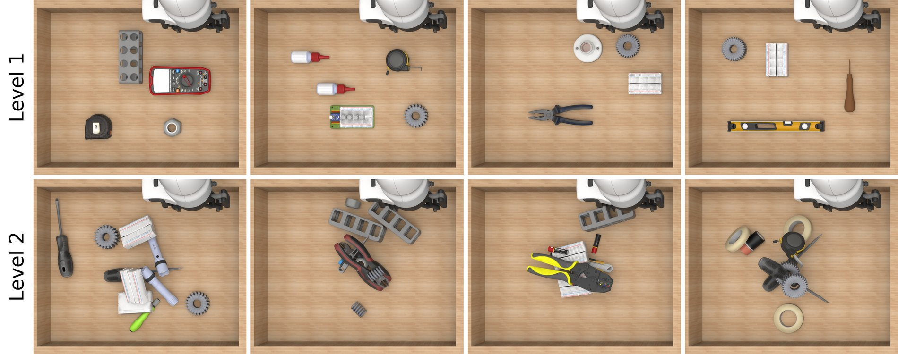
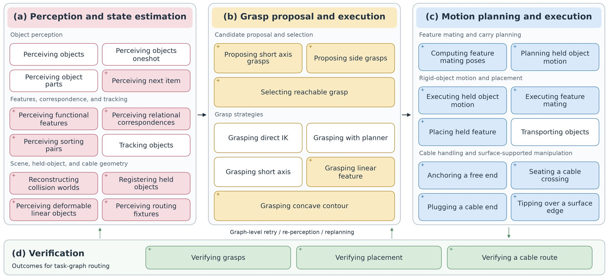

# VABAR: A Variational Automation Benchmark for Agentic Robotics

<!-- TODO(authors): add affiliations and confirm the meaning of the asterisk before release. -->
Shuangyu Xie<sup>*</sup>, Kaiyuan Chen, Uksang Yoo, Xinyue Zhu, Meadow Shen, Jaimyn Drake, Eugen Solowjow,
Lionel Gulich, Alexander Millane, Rafael Cathomen, Tuur Stuyck, Sangeeta Subramanian, Yichao Pan,
Bruce McGowan, Michael Benedict, Linxi Fan, Yuke Zhu, Spencer Huang, Ken Goldberg

[Project page](https://vabar-benchmark.github.io/) | [RoboSimStudio](https://github.com/robosimstudio/robosimstudio) | [Skill library](https://github.com/graph-robots/open-robot-skills)

<p align="center">
  
</p>

VABAR is a benchmark for robots that repeat one job across a known distribution of
variation. It has six manipulation task classes taken from industrial, medical and
infrastructure applications. Each class has two difficulty levels and a fixed set of
seeded instances. VABAR runs on the [Newton](https://github.com/newton-physics/newton)
physics engine through [RoboSimStudio](https://github.com/robosimstudio/robosimstudio).

| Task classes | Difficulty levels | Asset library | Skill library | Instances per cell | Embodiments |
| :---: | :---: | :---: | :---: | :---: | :---: |
| 6 | 2 | 55+ | 33 | N = 30 | Franka (single arm), YAM (bimanual) |

## Abstract

Robots in commercial and industrial settings must keep doing specific tasks while the
shape and pose of the objects vary in known ways. We call this setting **Variational
Automation (VA)**, to distinguish it from fixed automation. Recent work on agentic
robotics combines programs written by pretrained LLM and VLM coding agents, which are
easy to inspect, with model-free policies, which adapt to open-world conditions.

We propose design criteria for agentic-robotics benchmarks:
- accessibility;
- repeatability;
- diversity;
- relevance to agentic robotics and to practical applications;
- physical realizability;
- resistance to benchmark saturation;
- computational efficiency.

We apply these criteria to six manipulation task classes: tool sorting, tool hanging,
gear meshing, syringe packing, cable insertion and cable routing.

VABAR, the **Variational Automation Benchmark for Agentic Robotics**, is open,
simulation-based and easy to replicate. It is built entirely on open-source tools. It
provides:
- task implementations on the Newton physics engine;
- standardized task variations;
- difficulty tiers;
- success metrics;
- a library of 33 skills that generalize across tasks, with programmatic reference
  solutions written by people.

We report initial baselines from an open agentic manipulation harness, Graph-as-Policy
(GaP), and from a second implementation on Isaac Lab Arena.

### What a VA task is

A VA task class is a tuple $T = (E, R, A, O, p_O, S)$:

| Symbol | Meaning |
| --- | --- |
| $E$ | environment coordinate frames |
| $R$ | robot and gripper |
| $A$ | admissible assets, each with physical properties and a collision mesh |
| $O$ | space of admissible object configurations |
| $p_O$ | distribution over that space |
| $S$ | measurable success condition |

An instance $\tau_i = \lbrace (a_j, x_j) \rbrace \in O$ pairs each asset with its
initial pose in $SE(3)$, and is drawn $\tau_i \sim p_O$ under a controlled seed.

Admissible variation is constrained in five ways:
- **task invariance:** every instance is still the same task;
- **physical feasibility:** objects are supported and not interpenetrating;
- **robot feasibility:** everything is within the robot's reach;
- **controlled difficulty:** levels widen the admissible region;
- **skill preservation:** every instance at a level can be solved with the same skills.

<p align="center"></p>

## The six task classes

| | Task class | Setting | Robot | Level 1 | Level 2 |
| --- | --- | --- | --- | --- | --- |
|  | **1 · Tool Sorting** (`tool_sort`) | workshop | Franka | Singulated tools, no distractors | Cluttered tools that overlap and occlude |
|  | **2 · Tool Hanging** (`tool_hanging`) | workshop | Franka | One tool, known fixture pose | Multiple tools and fixture types, randomized poses |
|  | **3 · Gear Meshing** (`gear_mesh`) | assembly | Franka | Assemble two gears | Assemble three gears |
|  | **4 · Syringe Packing** (`syringe_packing`) | healthcare | Franka | Singulated targets | Cluttered scenes, diverse syringe types |
|  | **5 · Cable Insertion** (`usbc_insert`) | data centre | YAM, bimanual | Fixed, visible port; connector nearby with small misalignment | Randomized port pose; moderate connector misalignment |
|  | **6 · Cable Routing** (`cable_route`) | data centre | YAM, bimanual | 2–3 widely spaced pegs, short route | 4–6 moderately spaced pegs, multiple turns |

Each class fixes an operational objective and names the axes its instances vary along:

| Task class | Varies |
| --- | --- |
| Tool sorting | tool types, poses and density |
| Tool hanging | tool type, number of tools, tool pose, holder pose |
| Gear meshing | number of gears, gear size, initial poses |
| Syringe packing | number of objects, disposal box type |
| Cable insertion | connector pose, port pose |
| Cable routing | peg count, position and spacing; route; cable length, slack and curvature; board pose |

<p align="center"></p>

## Installation

VABAR needs Linux, an NVIDIA GPU, Python 3.12 and [uv](https://docs.astral.sh/uv/).
RoboSimStudio, Newton, the GaP runtime and cuRobo are installed from Git at pinned
revisions (see `pyproject.toml`).

```bash
git clone https://github.com/BerkeleyAutomation/VABAR.git
cd VABAR
uv sync
uv run python -m vabar list            # 374 variants across the six suites
```

The environment is about 12 GB. `UV_NO_GROUP=rtx uv sync` leaves out the path-traced
renderer on a GPU without RT cores.

That is enough for the tasks, the scripted groundtruth and the Studio. The GaP graphs
also need the skill library. Its bundles resolve the graph runtime from a sibling
checkout, so all three repositories sit side by side:

```bash
cd ..   # the directory holding VABAR/
git clone https://github.com/KeplerC/open-robot-skills.git
git -C open-robot-skills checkout b15859a244658abc6060f3aa3b6827780746a5fe
git clone https://github.com/KeplerC/graph-as-policy.git
git -C graph-as-policy checkout 06dd6193e13eab816123febef1369deda0849d91
(cd open-robot-skills/tools/curobo && CUDA_HOME=/usr/local/cuda uv sync)   # cuRobo tool bundle, once
```

The perception graphs use SAM 3, GroundingDINO and a VLM. The models are downloaded
the first time a bundle uses them. SAM 3 is a gated Hugging Face model, so set
`HF_TOKEN` first. The VLM is configured with `GAP_VLM_*`. See
[`docs/running_graphs.md`](docs/running_graphs.md).

## Quick start

```bash
uv run python -m vabar list                                                  # every suite/variant
uv run python -m vabar run --task tool_hanging/wrenches_level1 --solve routine --record
uv run python -m vabar run --task tool_hanging/scissors_level1 --solve graph --graph gt --bus-timeout 180
uv run python -m vabar run --task tool_hanging/wrenches_level1 --episodes 1 --solve graph --graph gap_perception \
    --motion curobo --no-privileged --perception vision --bus-timeout 180 --max-steps 8500
uv run python -m vabar studio --task gear_mesh/gearmesh-easy-pair-01          # the interactive Studio
```

`vabar run` is RoboSimStudio's own headless runner (`scripts/bench_run.py`) with the
VABAR suites registered. Its main options:
- `--solve`: the policy, which is one of
  - `routine`, the scripted groundtruth;
  - `graph`, a GaP computation graph the task ships, chosen with `--graph`;
  - `idle`;
  - a dotted path to your own solution class.
- `--episodes`: one instance or several, e.g. `0:30` or `3,7,11`.
- `--workers`: run episodes in parallel processes.
- `--record`: keep video and state.

`python -m vabar run --help` lists everything.

### Interactive Studio

```bash
uv run python -m vabar studio --task tool_sort/level1_1 --port 8080
```

This opens the [RoboSimStudio Studio](https://github.com/robosimstudio/robosimstudio/tree/main/examples/05_studio)
on a VABAR task. Open the printed URL, forwarding the port from a remote machine. The
Studio has these panels:
- **Task**: lists all six suites and their variants; picking one loads it.
- **Goal**: scores the scene clause by clause as you drive it.
- **Policy**: runs the scripted `routine` or any graph the task ships.

You can also drive the arms by hand, record a take and export video.

## The benchmark

The benchmark has twelve cells: six task classes × two levels, with 30 seeded
instances each. They are listed in [`benchmark/vabar_v1.json`](benchmark/vabar_v1.json)
and generated from the frozen instance documents under [`benchmark/`](benchmark/).
Each instance is a `(task, episode)` pair on the registered suites, so running a cell
is an ordinary run over an episode list:

```bash
uv run python -m vabar bench --list                                   # the cells
uv run python -m vabar bench --cell tool_hanging/L1 --solve graph     # the cell's reference graph, 30 instances
uv run python -m vabar bench --cell cable_insertion/L2 --print        # the resolved jobs, as vabar run commands
uv run python -m vabar bench --cell tool_hanging/L1 --verify          # resets match the frozen transforms
```

A cell runs as one runner invocation: `vabar bench` writes a job file (one job per task
the instances live on) to `outputs/<config>/<cell>/jobs.py` and runs it once, so a pool
of workers pulls fleet waves from the whole cell.

### Experiment configs

A cell fixes *what* is measured: the instances, the graph and its flags. An experiment
config fixes *how* the run executes. Three ship in [`vabar/configs/`](vabar/configs/):

| Config | What it is |
| --- | --- |
| `default` | One GPU, the benchmark's own scenes. The simulator waits while the graph thinks (`clock = "lockstep"`) and renders observations only when the graph asks for them (`obs_render = "on-demand"`, RTX). SAM 3, DINO and the other tool servers, and cuRobo, stay up across episodes. Graph traces keep their JSON records but skip the per-call image, mask and depth files (`trace_assets = false`; `--set trace_assets=true` restores them). A task's instances run as fleet waves of up to 8 worlds (15 for cable routing L1). Each suite runs several worker processes, sharing the GPU through a private NVIDIA MPS daemon (`mps = true`) and one SAM 3 / GroundingDINO server between them (`share_tool_servers = true`); because of the lockstep clock this changes wall time, not outcomes. Physics, cameras, step budgets and the tool-sorting VLM (Gemini 2.5 Flash) are the suites' own. |
| `fast` | `default`, plus cheaper physics where a full 30-instance cell showed no change in outcome: gear meshing at 8 substeps (and half-resolution views), syringe packing at 200 Hz on 16 workers, tool sorting at 300 Hz with a 14,000-step budget and Gemini 3.1 Flash-Lite as its VLM, cable insertion with CUDA-graph capture, cable routing with a lighter rod solver. Tool hanging runs as in `default`. It runs the first 15 of a cell's 30 instances, to try a change quickly; add `--limit 30` for the whole cell, which any comparison with the paper needs. |
| `paper` | The v1.0 protocol exactly: a free-running clock, every camera rendered every step, the cells' own flags and environment, one task at a time. `vabar bench --config paper --print` prints the v1.0 commands verbatim. |

**What a cell costs on one GPU.** These are whole 30-instance cells (`--limit 30` under `fast`) with their reference GaP graphs on one RTX PRO 6000
(96 GB), measured 2026-11-05 on a warm shader cache, one cell per GPU of a shared 240-core host with other jobs running:
wall time from launch to exit, and the GPU's peak memory. `paper` figures are estimates from single episodes. `default`
figures predate the fixes below, and where a cell says 1 worker they also predate workers and MPS.

*Solved* counts whole instances. *Paper's measure* is how the paper counts: one trial per object where a task's objects
are independent (tool sorting, tool hanging), per seated gear for gear meshing (read here from mean reward), and per
instance otherwise. A range is several runs: one run does not pin these down, and tool sorting scored 7/30 and 13/30 on
the same settings.

| Cell (L1) | `paper` (est.) | `default` | `fast` | Workers (`fast`) | GPU peak | Solved | Paper's measure | Paper (GaP Human-Newton) |
| --- | --- | --- | --- | --- | --- | --- | --- | --- |
| Tool hanging | 5-7 h (10-14 min/episode) | 5-7 min | 5-8 min | 2 x 8-world waves | 22.5 GB | 29-30/30 | 98-100% of tools | 86.7% |
| Gear meshing | 8-10 h (16-20 min/episode) | 76 min (1 worker) | 10-14 min | 8 | 42.6 GB | 29-30/30 | 98-100% of gears | 100.0% |
| Syringe packing | hours | 21-23 min | 13-14 min | 16 | 40 GB | 26-27/30 | 87-90% | 87.0% |
| Cable insertion | ~3.5 h | not run | 16.5 min | 8 | 40.2 GB | 30/30 | 100% | 86.7% |
| Tool sorting | hours | not run | 12-14 min | 15 | 90 GB | 7-12/30 | 72-81% of objects | 47.1% |
| Cable routing | more than `default`'s 1-worker time | ~5 h (1 worker) | about 16 min | 2 x 15-world waves | 12.2 GB | 15-23/30 | 50-77% | 46.7% |

| Cell (L2, `fast`) | Wall | Workers | GPU peak | Solved | Paper's measure | Paper (GaP Human-Newton) |
| --- | --- | --- | --- | --- | --- | --- |
| Tool hanging | 12-17 min | 2 x 8-world waves | 23.6 GB | 21-26/30 | 83-93% of tools | 81.7% |
| Gear meshing | 13.7-15.0 min | 8 | 43.2 GB | 21-23/30 | 89-92% of gears | 90.0% |
| Syringe packing | 31-35 min | 16 | 40 GB | 14-19/30 | 47-63% | 63.0% |
| Cable insertion | 25-30 min | 8 | 45 GB | 20-24/30 | 67-80% | 30.0% |
| Tool sorting | 28-37 min | 15 | 90 GB | 0-2/30 | 57-64% of objects | 33.7% |
| Cable routing | 21-23 min | 2 x 15-world waves | 11.7 GB | 12-21/30 | 40-70% | 46.7% |

At `fast`'s 15 instances a cell took 4-25 min (one pass from a new install, seven cells at once), against 5-36 min for all 30. Tool hanging L2 and both cable routing cells save little, because they run as fleet waves: fewer worlds, but about the same waves. Syringe packing scored below its full cells in that pass, 10/15 on L1 and 4/15 on L2, which is not yet explained.

Tool sorting L2 is the heap tier: `fast` gives each document its own budget, capped at 20,000 steps, and whole instances are rarely solved. Syringe packing runs the working scene (61-hull syringes, walled tray, corrected layouts) on a Robotiq with the tiled renderer under every config, including `paper`. L1 is above the paper, and L2 reaches it only on its best run (`docs/validation/syringe_working_scene.md`). Cable routing L2's
repaired episodes can run to 19,000 steps, so `fast` caps its budget at 14,000, which cost 1 of 83 successes at the
declared servo speed. Gear meshing and cable routing L2 declare the servo speed their graphs were
written at; on the other task classes tested, declaring it did not help.

A worker that stops making progress is killed and its episode re-run, so a rare renderer hang costs a cell up to 15
minutes rather than the rest of the run. Gear meshing L1's run took 20.2 min in all for that reason; its other 29
episodes were done by about 14.

On a smaller card a suite's worker count is held to what fits:
`floor((free GB - shared_gb) / worker_gb)`. The figures in `default.toml` come from the peaks above. A 48 GB card
still runs every cell's full count except tool sorting's (6 workers instead of 15).

Most of tool sorting's failing episodes loop until the step budget runs out. `fast` uses Gemini 3.1 Flash-Lite, which
answers in about 0.9 s and does not think. The RTX pipelines compile once per
install, 5-8 minutes on the first cell that renders, and are then copied for its workers. Both cable routing cells run as fleet waves.

```bash
uv run python -m vabar bench --cell tool_hanging/L1                      # default
uv run python -m vabar bench --cell tool_hanging/L1 --config paper       # the paper's protocol
uv run python -m vabar bench --cell gear_meshing/L1 --config my.toml     # your own (inherits = "default")
uv run python -m vabar run --task tool_hanging/wrenches_level1 --solve graph --graph gt \
    --set clock=free --set suites.tool_hanging.max_steps=9000            # override single keys
```

- `--config NAME|path.toml` works on `vabar run`, `vabar bench`, `vabar studio` and
  `vabar warmup`; `VABAR_CONFIG` selects one when the flag is absent. `--set key=value`
  overrides one key on top (`clock=free`, `runtime.env.NAME=value`,
  `suites.<suite>.physics=<name>@v1`, ...). Flags on the command line still win.
- `[runtime]` sets the clock, observation rendering, renderer, worker count, MPS, waves and
  environment. `[suites.<suite>]` (or `[suites."<suite>/<variant>"]`) sets a registered
  `physics` arrangement or `cameras` rig, `max_steps`, `num_worlds`, `env`, extra `flags`,
  and `variants = { old = "new" }` to run a benchmark instance on another variant. A suite
  table also sets `workers`, a ceiling measured on a 96 GB GPU, and `worker_gb`. On a
  smaller GPU the count is held to free memory / `worker_gb`, and `--set workers=N`
  overrides it.
  Physics, cameras and budgets rewrite the registered variants, so they hold in every
  process, pool and fleet workers included. See [`vabar/config.py`](vabar/config.py).
- Every run directory gets a `vabar_config.json`: the resolved config, its sha256 and
  the VABAR commit.
- A cell's first `vabar bench --solve graph` on an install warms its first scene, and the install's first RTX cell
  also compiles the pipelines (`--no-warmup` skips both). Skipped on a cold install, the first perception times out
  and the episodes abort. The driver's files take about 134 MB per worker, 2 GB on one GPU and at most 9.6 GB, inside
  `.venv`; delete `ovrtx/bin/cache/nv_shadercache` to reclaim them and the next run compiles once more.
- Before timing anything on a new machine, run `uv run python -m vabar warmup`. It takes
  one idle step of each suite on its own renderer (RTX, except syringe packing), so the RTX pipelines (5-8 minutes
  the first time) and the Warp kernels are compiled once, not inside your first
  measurement. `python tools/profile_instance.py <run dir>` then shows where a run's wall
  time went: build, stepping, and the graph's perception, motion, robot tools and planning.

**How success is counted.**
- **Independent attempts:** in tasks built from attempts that are independent by
  construction (sorting or hanging separately sampled objects), each object-level
  attempt is a trial. Success rate is the fraction of objects manipulated successfully.
  A hung tool counts once it has been let go: no hand within the tool's own radius of it,
  for a second ([`docs/validation/tool_hanging.md`](docs/validation/tool_hanging.md)).
- **Sequential, state-dependent tasks:** in tasks like gear meshing, the whole instance
  is the unit, and subgoal success is reported as a diagnostic.
- **Cycle time:** simulated time from policy start to success, failure or timeout. The
  tables report the median over successful trials.

### Baseline results (from the paper)

Success rate (%) and median cycle time (simulated seconds) over N = 30 instances per
cell (GaP Human–ILA: N = 40, on its own instances). A dash means no successful trial.

| Task | Level | GaP (Human–Newton) | GaP (Human–ILA) | Claude Code | GaP |
| --- | :---: | ---: | ---: | ---: | ---: |
| Tool Sorting | L1 | 47.1 · 421.6 | 20.0 · 555.0 | 0.0 · — | 26.7 · 134.2 |
| | L2 | 33.7 · 913.8 | — | 0.0 · — | 13.3 · 232.3 |
| Tool Hanging | L1 | 86.7 · 86.1 | 67.5 · 98.3 | 16.7 · 96.2 | 33.3 · 81.5 |
| | L2 | 81.7 · 158.4 | 50.0 · 138.3 | 10.0 · 190.8 | 10.0 · 270.9 |
| Gear Meshing | L1 | 100.0 · 165.9 | 87.5 · 198.9 | 0.0 · — | 70.0 · 156.6 |
| | L2 | 90.0 · 235.5 | 80.0 · 381.3 | 0.0 · — | 60.0 · 284.1 |
| Syringe Packing | L1 | 87.0 · 228.8 | 52.5 · 939.0 | 0.0 · — | 33.3 · 371.1 |
| | L2 | 63.0 · 472.3 | 40.0 · 1810.0 | 0.0 · — | 12.1 · 652.2 |
| Cable Insertion | L1 | 86.7 · 78.8 | 97.5 · 104.9 | 0.0 · — | 36.7 · 79.0 |
| | L2 | 30.0 · 74.2 | 17.5 · 118.8 | 0.0 · — | 23.3 · 80.5 |
| Cable Routing | L1 | 46.7 · 116.0 | 50.0 · 145.9 | 3.3 · 120.7 | 36.7 · 50.8 |
| | L2 | 46.7 · 189.8 | 5.0 · 151.5 | 0.0 · — | 13.3 · 120.3 |

The four systems:
- **GaP (Human):** a computation graph specified by hand over the skill library. This
  repository ships it as each task's reference graph.
- **Claude Code:** a general-purpose coding agent (Claude Opus 5) with no robotics
  harness or skill library.
- **GaP:** the graph generated autonomously by the same model, over the same skill library.

These are the paper's numbers. [`docs/VALIDATION.md`](docs/VALIDATION.md) records what
this release reproduces on the pinned RoboSimStudio. Both cable cells failed at first
under the shipped protocol. In both, the graph's perception had been tuned on a different
camera rig from the one the benchmark stages:
- Cable insertion's `mate` was written for a straight-down camera. On the benchmark's
  oblique head camera, the port's visible side wall dragged its read of the port 8–10 mm
  off, a later check then threw away the correct close-up read, and the plug was
  released about 16 mm off the bore. Reading the port from its roof alone fixes it:
  0/30 before, 30/30 after.
- Cable routing's terminal detector had a pixel floor measured on a 1280×960 camera,
  while the benchmark renders 1280×720, so the port was never found: 4/30 before,
  16/30 after scaling the floor by the camera's focal length and keeping the open
  jaws off the port.
  Run as fleet waves since, the cell scored 16-20/30 in four runs, within the
  single-world runs' own spread.
- Cable routing L2 then scored 1-2/30. On its 80 mm peg pitch the crossing's fully open
  jaws came down on the next spool, and Medium-only branches of the graph let go of the
  end on top of the port, skipped its correction and switched off the seat-repair pass.
  Opening the jaws only as far as clears the pegs, and running Medium's terminal and
  repair as Easy's: 13-18/30 in three fleet cells and 15/30 single-world, at 34-57 min
  a cell.

See [`docs/validation/cable.md`](docs/validation/cable.md).

## Skill library

<p align="center"></p>

VABAR extends the [Modular Open Robot Skill Library](https://github.com/graph-robots/open-robot-skills)
with reusable procedures for the following:
- functional-feature manipulation;
- constrained placement;
- deformable cable handling, through metric feature localization, source–destination
  correspondence, in-hand registration and staged feature mating.

The skill bundles live in two places:
- **open-robot-skills:** all 33 skills, in a checkout beside this one. Override the
  location with `VABAR_OPEN_ROBOT_SKILLS` or `GAP_SKILLS_PATH`.
- **[`robot_skills/`](robot_skills/):** the 20 cable bundles, shipped in this repository.

A task's reference graph is a `workflow.json` plus node scripts under
`tasks/<suite>/graphs/<label>/`, composed from those skills. See
[`docs/running_graphs.md`](docs/running_graphs.md).

## Repository layout

```
tasks/<suite>/          one directory per task class, in RoboSimStudio's document format:
  <suite>.suite           what every variant shares: cell, robot, physics, cameras
  <variant>.task          one document per variant: objects, fixtures, goal, policies
  staging.py scenes.py    the arrangements, camera rigs and cell the documents name
  assets/                 asset records, entity code, meshes and collision hulls
  routine.py tools.py     the scripted groundtruth and the suite's own graph tools
  graphs/<label>/         reference GaP graphs (workflow.json + scripts/)
tasks/_shared/scripts/  graph node scripts several suites share
assets/                 the tool-sorting workcell export and robot models the suites use
benchmark/              frozen instance documents and manifests; vabar_v1.json, the twelve cells
robot_skills/           the cable-task GaP skill bundles
vabar/                  what RoboSimStudio does not ship: the routine hook, the CLI, the benchmark runner
docs/                   running graphs, cable tasks, validation records
```

## How VABAR uses RoboSimStudio

VABAR is a task collection for RoboSimStudio, not a fork of it. The pinned upstream
release is installed unmodified. VABAR attaches to it in three ways:
- **The suites are an external task root.** `vabar.install()` calls RoboSimStudio's
  `add_task_root("tasks/")`, and the `assets/` beside that root is searched
  automatically. Any RoboSimStudio entry point therefore sees them:
  `python scripts/bench_run.py --task-root tasks` from a RoboSimStudio checkout works too.
- **Scripted groundtruth.** The public RoboSimStudio release leaves out its
  scripted-routine module. [`vabar/routines.py`](vabar/routines.py) provides it, and each
  suite's `staging.py` imports `vabar`, so the `(:routine …)` the documents declare
  resolve in every process that scans the suites: CLI, Studio and pool workers.
- **Everything else** a suite needs beyond upstream lives in that suite's directory or
  in `vabar/`. That includes embodiments, goal measures and cable perception tools.

## Asset licences

Code is Apache-2.0. Robot models keep their own licences (see [NOTICE](NOTICE)).
[ASSET_PROVENANCE.md](ASSET_PROVENANCE.md) lists every object mesh and fixture with its
source, and flags the ones whose redistribution licence is still being confirmed.

## Citation

```bibtex
@inproceedings{xie2027vabar,
  title     = {{VABAR}: A Variational Automation Benchmark for Agentic Robotics},
  author    = {Xie, Shuangyu and Chen, Kaiyuan and Yoo, Uksang and Zhu, Xinyue and Shen, Meadow and
               Drake, Jaimyn and Solowjow, Eugen and Gulich, Lionel and Millane, Alexander and
               Cathomen, Rafael and Stuyck, Tuur and Subramanian, Sangeeta and Pan, Yichao and
               McGowan, Bruce and Benedict, Michael and Fan, Linxi and Zhu, Yuke and Huang, Spencer and
               Goldberg, Ken},
  booktitle = {IEEE International Conference on Robotics and Automation (ICRA)},
  year      = {2027},
  note      = {Under review}
}
```

## Acknowledgements

VABAR is built on:
- [RoboSimStudio](https://github.com/robosimstudio/robosimstudio)
- [Newton](https://github.com/newton-physics/newton)
- [Warp](https://github.com/NVIDIA/warp)
- [MuJoCo Warp](https://github.com/google-deepmind/mujoco_warp)
- [Graph-as-Policy](https://github.com/lgulich/graph-as-policy)
- [open-robot-skills](https://github.com/graph-robots/open-robot-skills)
- [cuRobo](https://github.com/NVlabs/curobo)
- [PyRoKi](https://github.com/chungmin99/pyroki)
- [viser](https://github.com/viser-project/viser)
- [Isaac Lab Arena](https://github.com/isaac-sim/IsaacLab-Arena)

Robot models come from MuJoCo Menagerie, ROS-Industrial and [i2rt](https://github.com/i2rt-robotics/i2rt).

## License

Apache License 2.0; see [LICENSE](LICENSE).
