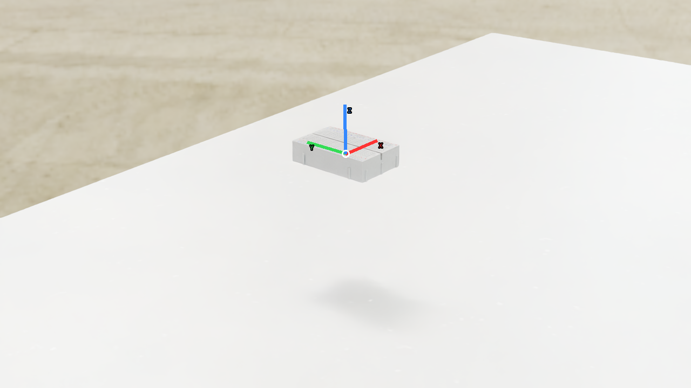
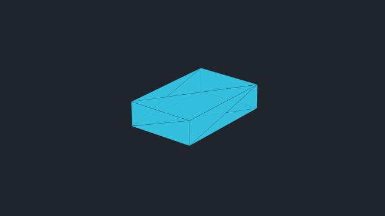
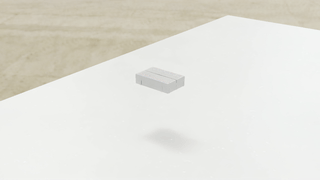

# vabar__breadboard

Generated with a fresh-process 10 cm drop test.

| Property | Value |
|---|---|
| Mass | 0.03474 kg |
| Friction | static=0.8, dynamic=0.8 |
| Restitution | 0 |
| Collider | Cube x1 |
| Physics profile | `tool_sort_mjwarp` |
| Drop-test status | **PASS** |
| Settling time | 0.120 s |
| Final penetration | 0.056 mm |
| Final-second movement | 9.4084e-05 m |
| Final-second rotation | 0 rad |
| Failure reasons | None |
