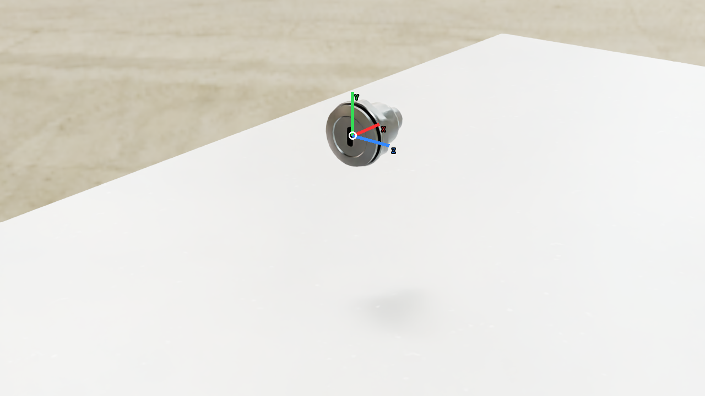
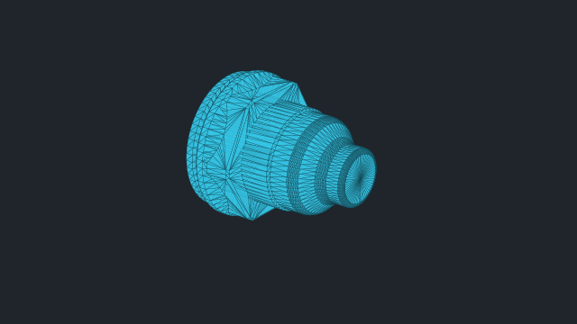
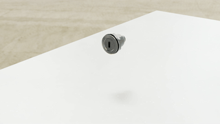

# vabar__bulkhead

Generated with a fresh-process 10 cm drop test.

| Property | Value |
|---|---|
| Mass | 0.09 kg |
| Friction | static=2.5, dynamic=2.5 |
| Restitution | 0 |
| Collider | Mesh[none] x1 |
| Physics profile | `usbc_native` |
| Drop-test status | **PASS** |
| Settling time | 0.583 s |
| Final penetration | -1.957 mm |
| Final-second movement | 6.22145e-06 m |
| Final-second rotation | 0 rad |
| Failure reasons | None |
