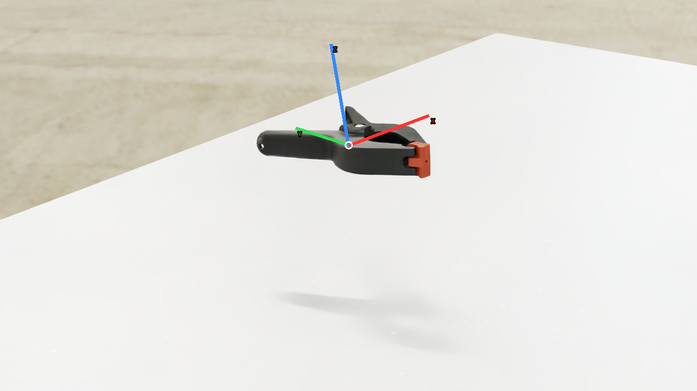
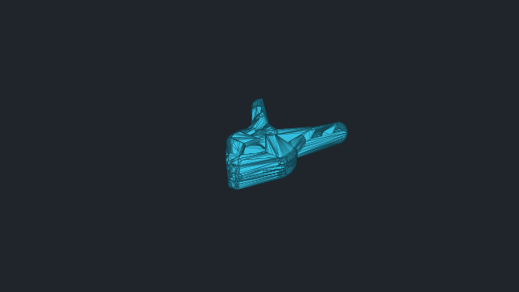
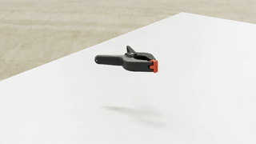

# vabar__clamp

Generated with a fresh-process 10 cm drop test.

| Property | Value |
|---|---|
| Mass | 0.251393 kg |
| Friction | static=2, dynamic=2 |
| Restitution | 0 |
| Collider | Mesh[convexHull] x39 |
| Physics profile | `tool_sort_mjwarp` |
| Drop-test status | **PASS** |
| Settling time | 0.480 s |
| Final penetration | 0.294 mm |
| Final-second movement | 3.22339e-05 m |
| Final-second rotation | 0.000598128 rad |
| Failure reasons | None |
