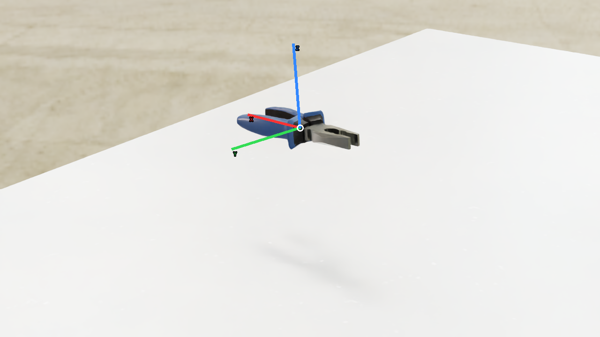
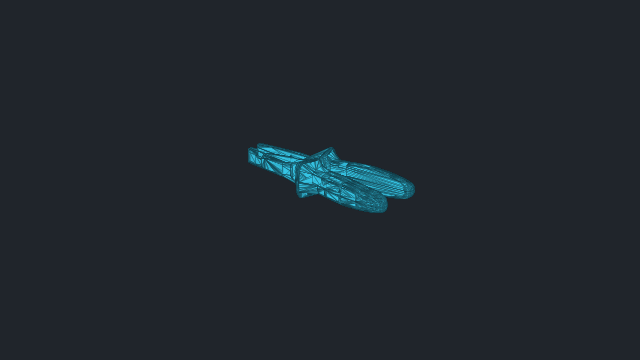
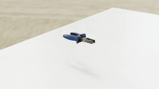

# vabar__combination_pliers

Generated with a fresh-process 10 cm drop test.

| Property | Value |
|---|---|
| Mass | 0.2 kg |
| Friction | static=0.8, dynamic=0.8 |
| Restitution | 0 |
| Collider | Mesh[convexHull] x31 |
| Physics profile | `tool_sort_mjwarp` |
| Drop-test status | **PASS** |
| Settling time | 0.400 s |
| Final penetration | 0.010 mm |
| Final-second movement | 5.13944e-09 m |
| Final-second rotation | 0 rad |
| Failure reasons | None |
