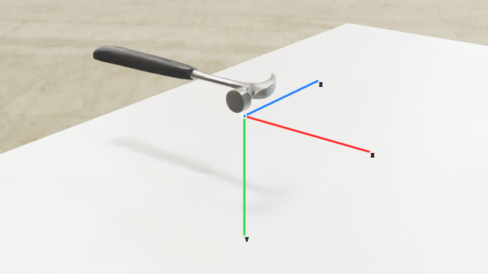
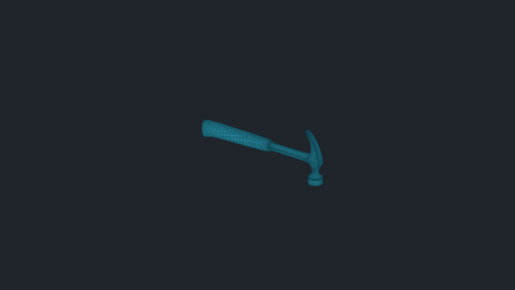
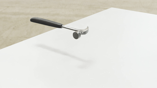

# vabar__hanging_hammer_1

Generated with a fresh-process 10 cm drop test.

| Property | Value |
|---|---|
| Mass | 0.639784 kg |
| Friction | static=0.3, dynamic=0.3 |
| Restitution | 0.1 |
| Collider | Mesh[convexDecomposition] x1 |
| Physics profile | `tool_hanging_mjwarp` |
| Drop-test status | **PASS** |
| Settling time | 0.217 s |
| Final penetration | 0.256 mm |
| Final-second movement | 2.09184e-11 m |
| Final-second rotation | 0.000186872 rad |
| Failure reasons | None |
