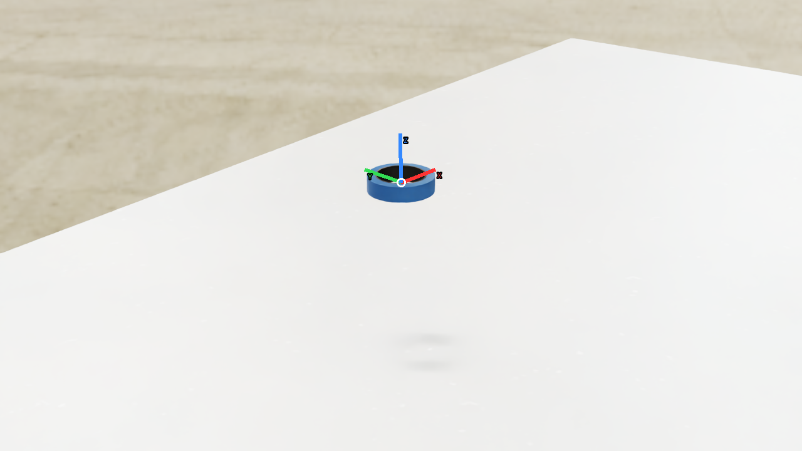
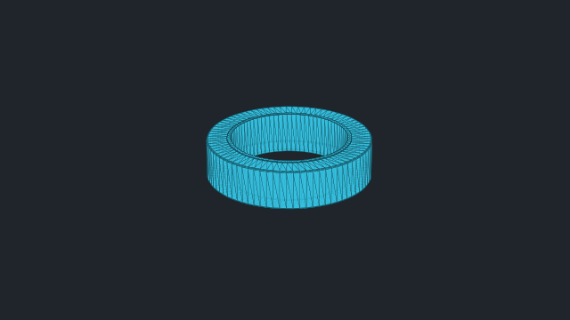
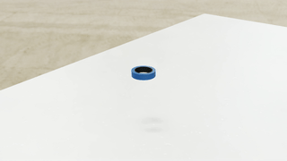

# vabar__insulating_tape

Generated with a fresh-process 10 cm drop test.

| Property | Value |
|---|---|
| Mass | 0.05 kg |
| Friction | static=0.4, dynamic=0.4 |
| Restitution | 0 |
| Collider | Mesh[sdf] x1 |
| Physics profile | `tool_sort_mjwarp` |
| Drop-test status | **PASS** |
| Settling time | 0.360 s |
| Final penetration | 0.354 mm |
| Final-second movement | 0.000182219 m |
| Final-second rotation | 0.010614 rad |
| Failure reasons | None |
