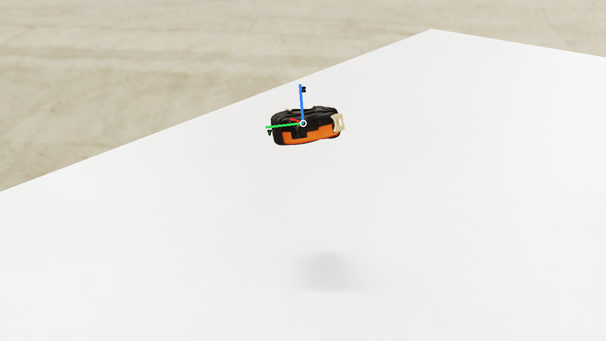
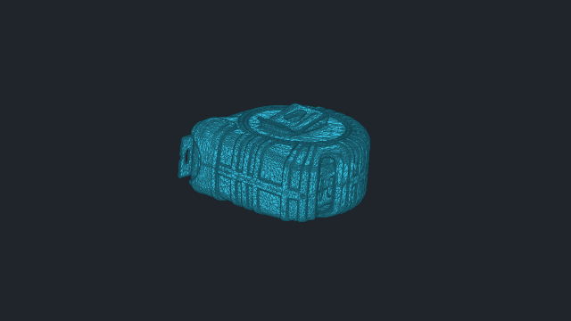
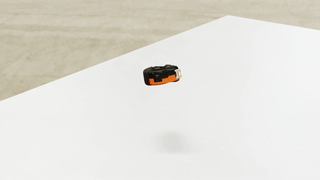

# vabar__measuring_tape

Generated with a fresh-process 10 cm drop test.

| Property | Value |
|---|---|
| Mass | 0.1 kg |
| Friction | static=1, dynamic=1 |
| Restitution | 0 |
| Collider | Mesh[sdf] x1 |
| Physics profile | `tool_sort_mjwarp` |
| Drop-test status | **PASS** |
| Settling time | 0.460 s |
| Final penetration | 0.400 mm |
| Final-second movement | 3.94075e-05 m |
| Final-second rotation | 0.00169748 rad |
| Failure reasons | None |
