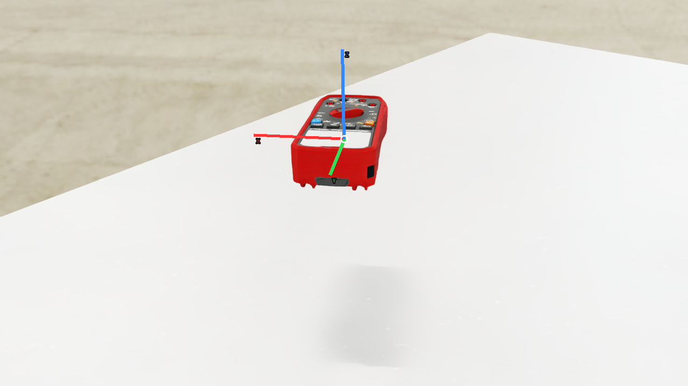
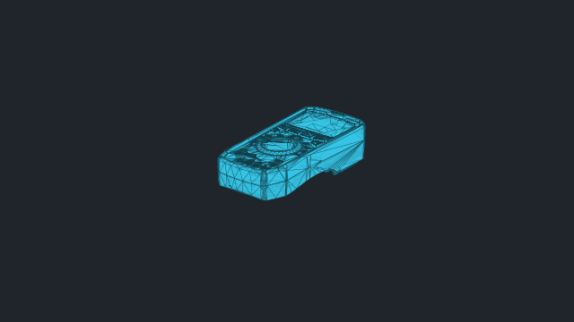
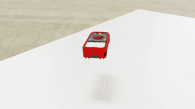

# vabar__multimeter

Generated with a fresh-process 10 cm drop test.

| Property | Value |
|---|---|
| Mass | 0.398371 kg |
| Friction | static=not authored, dynamic=not authored |
| Restitution | not authored |
| Collider | Mesh[convexDecomposition] x1 |
| Physics profile | `tool_sort_mjwarp` |
| Drop-test status | **PASS** |
| Settling time | 0.160 s |
| Final penetration | -0.338 mm |
| Final-second movement | 1.2495e-08 m |
| Final-second rotation | 0.000714808 rad |
| Failure reasons | None |
