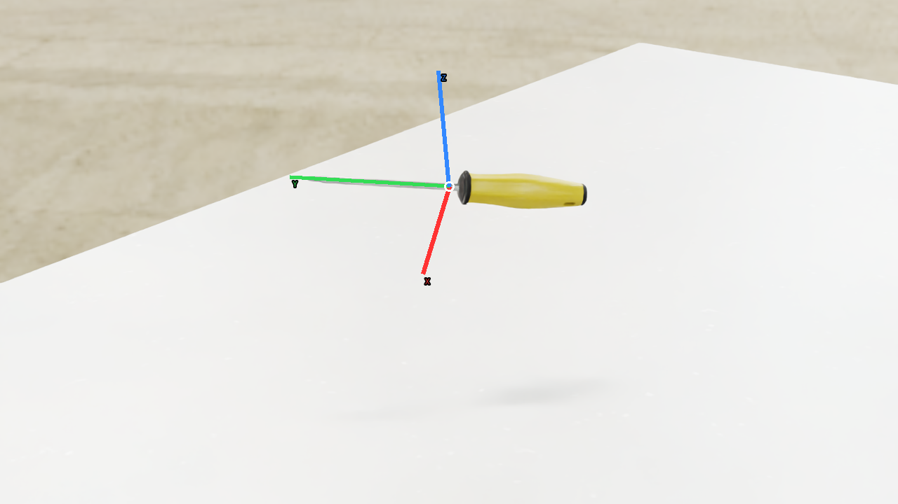
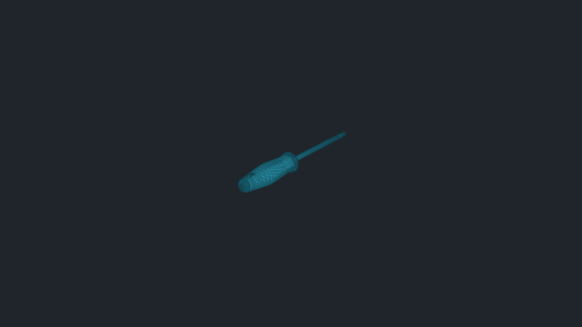
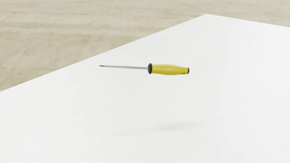

# vabar__phillips_screwdriver

Generated with a fresh-process 10 cm drop test.

| Property | Value |
|---|---|
| Mass | 0.0847674 kg |
| Friction | static=1, dynamic=1 |
| Restitution | 0 |
| Collider | Mesh[convexDecomposition] x1 |
| Physics profile | `tool_sort_mjwarp` |
| Drop-test status | **PASS** |
| Settling time | 7.800 s |
| Final penetration | -0.365 mm |
| Final-second movement | 0.000216187 m |
| Final-second rotation | 0.00928585 rad |
| Failure reasons | None |
