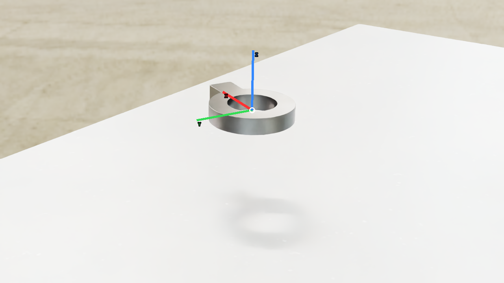
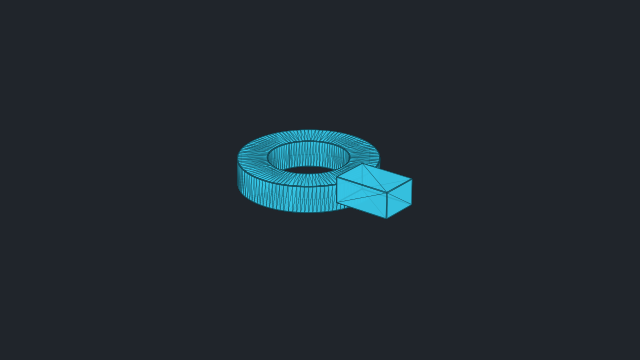
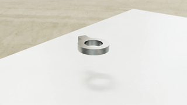

# vabar__round_nut

Generated with a fresh-process 10 cm drop test.

| Property | Value |
|---|---|
| Mass | 1.32506 kg |
| Friction | static=0.3, dynamic=0.3 |
| Restitution | 0.1 |
| Collider | Mesh[sdf] x9 |
| Physics profile | `tool_sort_mjwarp` |
| Drop-test status | **PASS** |
| Settling time | 0.160 s |
| Final penetration | 0.001 mm |
| Final-second movement | 6.02992e-08 m |
| Final-second rotation | 0 rad |
| Failure reasons | None |
