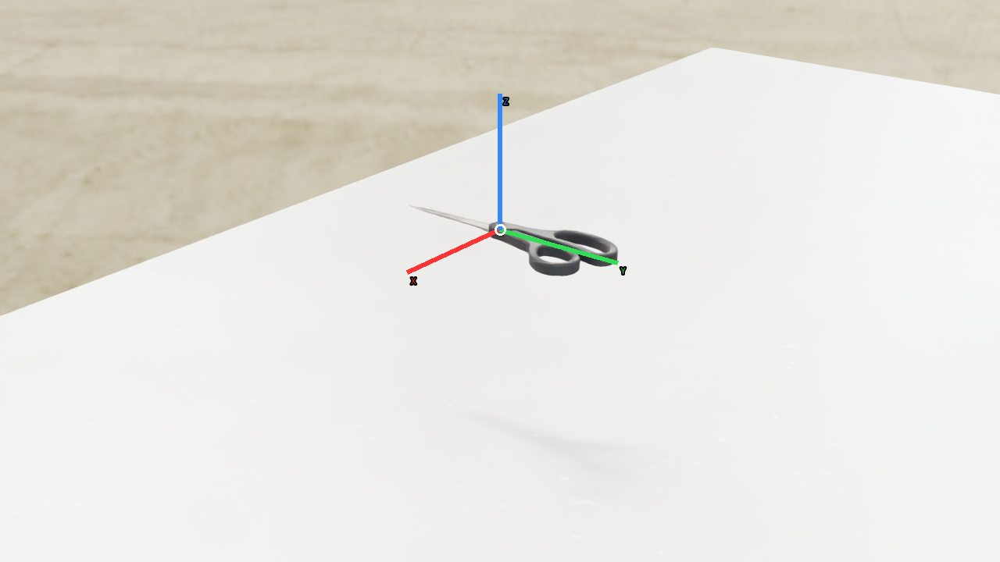
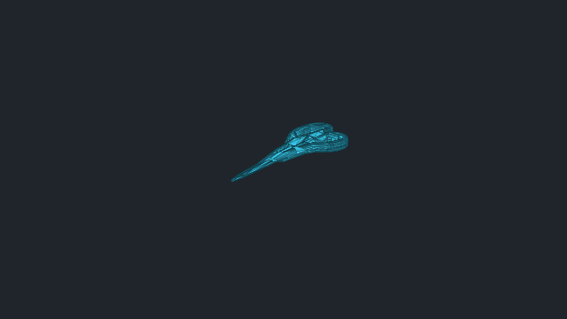
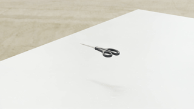

# vabar__scissor_pair_2

Generated with a fresh-process 10 cm drop test.

| Property | Value |
|---|---|
| Mass | 0.0815497 kg |
| Friction | static=0.7, dynamic=0.7 |
| Restitution | 0 |
| Collider | Mesh[convexHull] x59 |
| Physics profile | `tool_hanging_mjwarp` |
| Drop-test status | **PASS** |
| Settling time | 0.217 s |
| Final penetration | 0.041 mm |
| Final-second movement | 7.78241e-07 m |
| Final-second rotation | 0 rad |
| Failure reasons | None |
