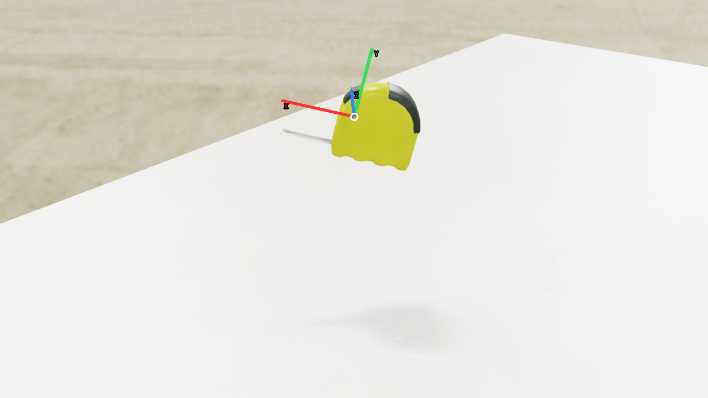
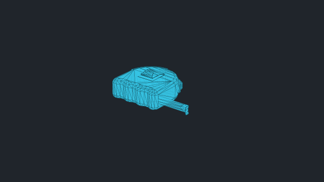
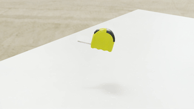

# vabar__tape_measure

Generated with a fresh-process 10 cm drop test.

| Property | Value |
|---|---|
| Mass | 0.25 kg |
| Friction | static=1, dynamic=1 |
| Restitution | 0 |
| Collider | Mesh[sdf] x1 |
| Physics profile | `tool_sort_mjwarp` |
| Drop-test status | **PASS** |
| Settling time | 0.540 s |
| Final penetration | 0.057 mm |
| Final-second movement | 4.11541e-05 m |
| Final-second rotation | 0.000546496 rad |
| Failure reasons | None |
