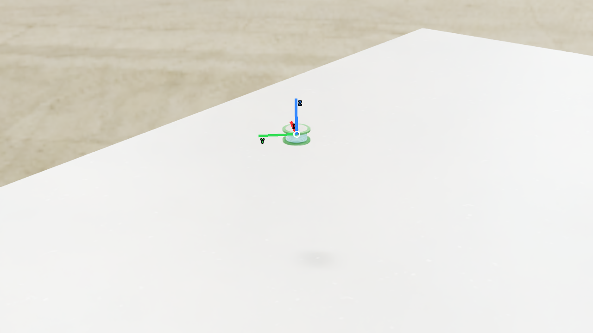
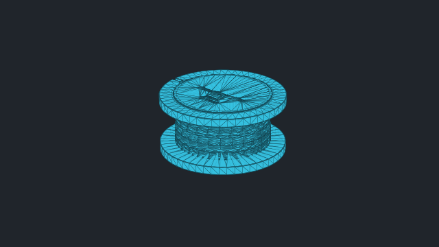
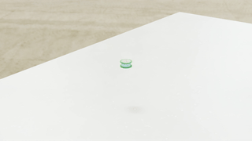

# vabar__wire_spool

Generated with a fresh-process 10 cm drop test.

| Property | Value |
|---|---|
| Mass | 0.00670301 kg |
| Friction | static=0.4, dynamic=0.4 |
| Restitution | 0.4 |
| Collider | Mesh[convexDecomposition] x1 |
| Physics profile | `tool_sort_mjwarp` |
| Drop-test status | **PASS** |
| Settling time | 0.120 s |
| Final penetration | 0.001 mm |
| Final-second movement | 6.58778e-08 m |
| Final-second rotation | 0 rad |
| Failure reasons | None |
