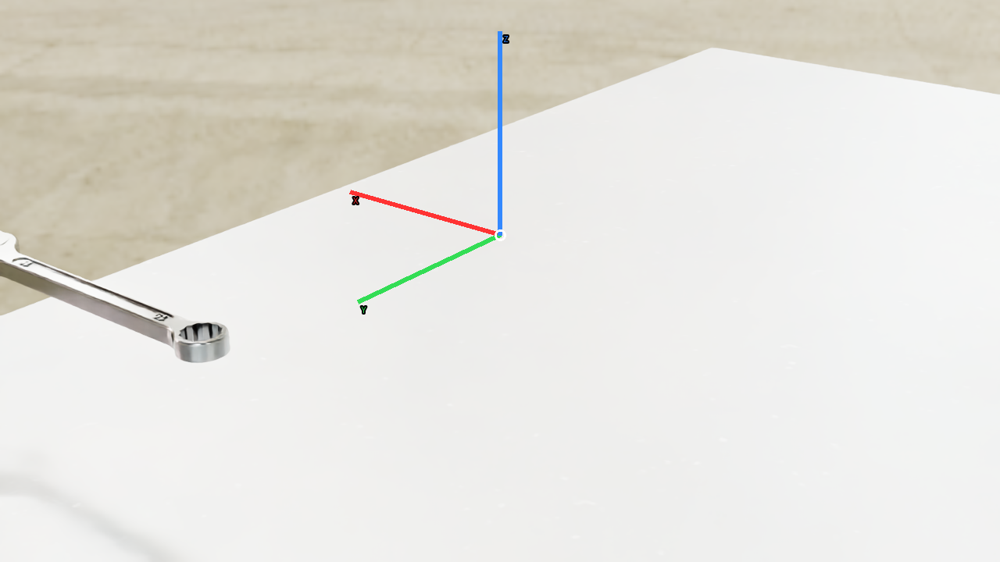
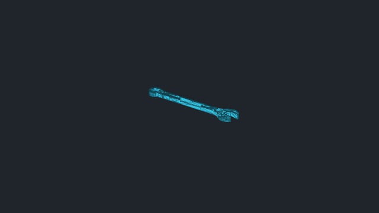
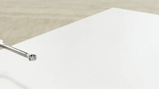

# vabar__wrench_ring_19

Generated with a fresh-process 10 cm drop test.

| Property | Value |
|---|---|
| Mass | 0.1 kg |
| Friction | static=1.5, dynamic=1.5 |
| Restitution | 0 |
| Collider | Mesh[convexHull] x44 |
| Physics profile | `tool_hanging_mjwarp` |
| Drop-test status | **PASS** |
| Settling time | 0.217 s |
| Final penetration | 0.005 mm |
| Final-second movement | 6.24823e-10 m |
| Final-second rotation | 0 rad |
| Failure reasons | None |
