# Industrial benchmark environments

Generated from the package-owned environment YAMLs with:

```bash
uv run tools/generate_environment_docs.py
```

Each GIF shows the first five simulated seconds after reset at 10 FPS. FR3 gear environments use `iso_camera`, other FR3 environments use `oblique_camera`, and YAM environments use `top_camera`. No floor plane is rendered; the HDR panorama supplies the visible floor background. Reset randomization covers task-relevant scene state; unlisted robots, cameras, and fixtures remain fixed.

## Tool sorting

| Environment | Definition | Reset randomization | First five seconds |
|---|---|---|---|
| [`easy_1`](tool_sorting/easy_1.yaml) | [`tool_sorting/easy_1.yaml`](tool_sorting/easy_1.yaml) | Four tools placed on the inset bin floor; randomized XY and full yaw; fixed destination labels. | <a href="media/tool_sorting/easy_1.gif">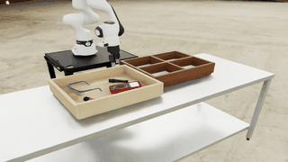</a> |
| [`easy_2`](tool_sorting/easy_2.yaml) | [`tool_sorting/easy_2.yaml`](tool_sorting/easy_2.yaml) | Four tools placed on the inset bin floor; randomized XY and full yaw; fixed destination labels. | <a href="media/tool_sorting/easy_2.gif">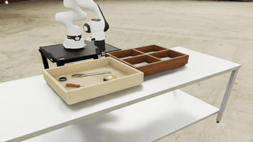</a> |
| [`easy_3`](tool_sorting/easy_3.yaml) | [`tool_sorting/easy_3.yaml`](tool_sorting/easy_3.yaml) | Four tools placed on the inset bin floor; randomized XY and full yaw; fixed destination labels. | <a href="media/tool_sorting/easy_3.gif">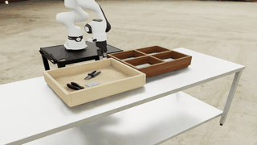</a> |

## Tool hanging

| Environment | Definition | Reset randomization | First five seconds |
|---|---|---|---|
| [`plier_easy`](tool_hanging/plier_easy.yaml) | [`tool_hanging/plier_easy.yaml`](tool_hanging/plier_easy.yaml) | One pair of pliers in a 4 x 4 cm XY region at the RSS table center; fixed heading. | <a href="media/tool_hanging/plier_easy.gif">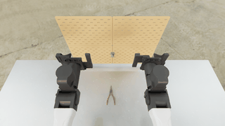</a> |
| [`plier_medium`](tool_hanging/plier_medium.yaml) | [`tool_hanging/plier_medium.yaml`](tool_hanging/plier_medium.yaml) | Two matching pairs of pliers with +/-5 cm XY and +/-5 deg yaw; two distractors; fixed fixtures. | <a href="media/tool_hanging/plier_medium.gif">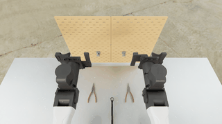</a> |
| [`scissors_easy`](tool_hanging/scissors_easy.yaml) | [`tool_hanging/scissors_easy.yaml`](tool_hanging/scissors_easy.yaml) | One pair of scissors in a 4 x 4 cm XY region at the RSS table center; fixed heading. | <a href="media/tool_hanging/scissors_easy.gif">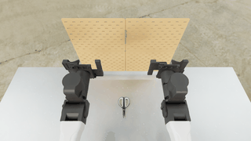</a> |
| [`scissors_medium`](tool_hanging/scissors_medium.yaml) | [`tool_hanging/scissors_medium.yaml`](tool_hanging/scissors_medium.yaml) | Two matching pairs of scissors with +/-5 cm XY and +/-5 deg yaw; two distractors; fixed fixtures. | <a href="media/tool_hanging/scissors_medium.gif">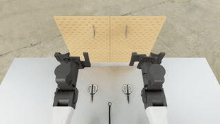</a> |
| [`screwdriver_easy`](tool_hanging/screwdriver_easy.yaml) | [`tool_hanging/screwdriver_easy.yaml`](tool_hanging/screwdriver_easy.yaml) | One screwdriver in a 4 x 4 cm XY region at the RSS table center; fixed heading. | <a href="media/tool_hanging/screwdriver_easy.gif">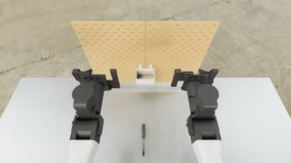</a> |
| [`screwdriver_medium`](tool_hanging/screwdriver_medium.yaml) | [`tool_hanging/screwdriver_medium.yaml`](tool_hanging/screwdriver_medium.yaml) | Two matching screwdrivers with +/-5 cm XY and +/-5 deg yaw; two distractors; fixed fixtures. | <a href="media/tool_hanging/screwdriver_medium.gif">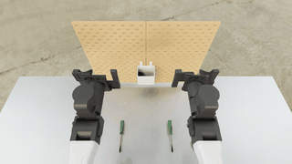</a> |
| [`wrench_easy`](tool_hanging/wrench_easy.yaml) | [`tool_hanging/wrench_easy.yaml`](tool_hanging/wrench_easy.yaml) | One wrench in a 4 x 4 cm XY region; fixed heading. | <a href="media/tool_hanging/wrench_easy.gif">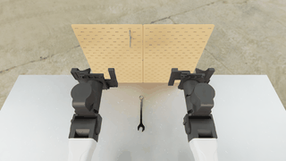</a> |
| [`wrench_medium`](tool_hanging/wrench_medium.yaml) | [`tool_hanging/wrench_medium.yaml`](tool_hanging/wrench_medium.yaml) | Two matching wrenches with +/-5 cm XY and +/-5 deg yaw; two distractors; fixed fixtures. | <a href="media/tool_hanging/wrench_medium.gif">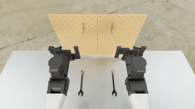</a> |

## Syringe disposal

| Environment | Definition | Reset randomization | First five seconds |
|---|---|---|---|
| [`both`](syringe_disposal/both.yaml) | [`syringe_disposal/both.yaml`](syringe_disposal/both.yaml) | Dispose of both syringes, laid out as one of AUTOLab's 30 tray_pair trials: both barrels across the tray, 90 mm apart along it, the tray at 140 deg +/-25 deg. The tray varies in a 10 x 10 cm XY region and the box in a 7 x 10 cm XY region. | <a href="media/syringe_disposal/both.gif">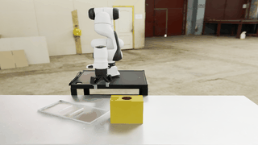</a> |
| [`cluttered`](syringe_disposal/cluttered.yaml) | [`syringe_disposal/cluttered.yaml`](syringe_disposal/cluttered.yaml) | Dispose of six syringes, one red-cap and five blank spares, in one of AUTOLab's six-syringe clutter layouts: a row along the tray, each barrel across it with up to 35 deg of yaw jitter, neighbours allowed to cross. The tray keeps AUTOLab's 140 deg heading and varies in a 10 x 10 cm XY region; the box varies in a 7 x 10 cm XY region. | <a href="media/syringe_disposal/cluttered.gif">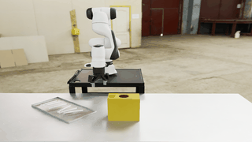</a> |
| [`designated`](syringe_disposal/designated.yaml) | [`syringe_disposal/designated.yaml`](syringe_disposal/designated.yaml) | Dispose of the red-cap syringe, leaving its blank spare. The tray varies in a 10 x 10 cm XY region and the box in a 7 x 10 cm XY region; syringes use random on-tray positions with a 1 cm edge margin; fixed headings. | <a href="media/syringe_disposal/designated.gif"></a> |
| [`single`](syringe_disposal/single.yaml) | [`syringe_disposal/single.yaml`](syringe_disposal/single.yaml) | Dispose of one syringe. The tray varies in a 10 x 10 cm XY region and the box in a 7 x 10 cm XY region; syringes use random on-tray positions with a 1 cm edge margin; fixed headings. | <a href="media/syringe_disposal/single.gif"></a> |

## USB-C insertion

| Environment | Definition | Reset randomization | First five seconds |
|---|---|---|---|
| [`easy`](usbc_insertion/easy.yaml) | [`usbc_insertion/easy.yaml`](usbc_insertion/easy.yaml) | The cabled plug moves +/-1.2 cm in X/Y with +/-8 deg yaw; the bolted port moves +/-0.5 cm across and +/-0.15 cm along the bore with +/-5 deg yaw; fixed Z. | <a href="media/usbc_insertion/easy.gif">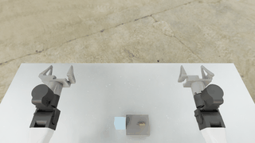</a> |
| [`medium`](usbc_insertion/medium.yaml) | [`usbc_insertion/medium.yaml`](usbc_insertion/medium.yaml) | The plug moves +/-1.8 cm in X/Y with +/-50 deg yaw; the bulkhead moves +/-0.4 cm in X/Y with +/-3 deg yaw. | <a href="media/usbc_insertion/medium.gif">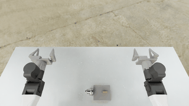</a> |

## Gear insertion

| Environment | Definition | Reset randomization | First five seconds |
|---|---|---|---|
| [`easy`](gear_insertion/easy.yaml) | [`gear_insertion/easy.yaml`](gear_insertion/easy.yaml) | One gear (16, 20, or 24 teeth, with the matching board) on the mat with full yaw; the board varies in a 6 x 6 cm XY region with +/-10 deg yaw. | <a href="media/gear_insertion/easy.gif">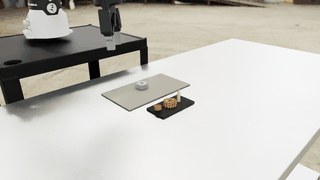</a> |
| [`easy_pair`](gear_insertion/easy_pair.yaml) | [`gear_insertion/easy_pair.yaml`](gear_insertion/easy_pair.yaml) | One jointly sampled RSS two-station layout per rebuild. | <a href="media/gear_insertion/easy_pair.gif">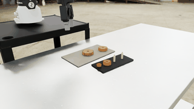</a> |
| [`medium_train`](gear_insertion/medium_train.yaml) | [`gear_insertion/medium_train.yaml`](gear_insertion/medium_train.yaml) | One jointly sampled RSS train layout per rebuild. | <a href="media/gear_insertion/medium_train.gif">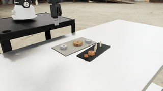</a> |

## Cable routing

| Environment | Definition | Reset randomization | First five seconds |
|---|---|---|---|
| [`easy`](cable_routing/easy.yaml) | [`cable_routing/easy.yaml`](cable_routing/easy.yaml) | `layout_seed` jointly samples the cable shape, its anchor, and the valid two-peg board. Seed 10009 is the regression layout. | <a href="media/cable_routing/easy.gif">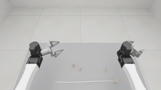</a> |
| [`medium`](cable_routing/medium.yaml) | [`cable_routing/medium.yaml`](cable_routing/medium.yaml) | `layout_seed` jointly samples the 840 mm cable, anchor, four-guide board and port. | <a href="media/cable_routing/medium.gif">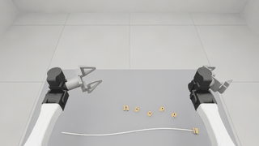</a> |
