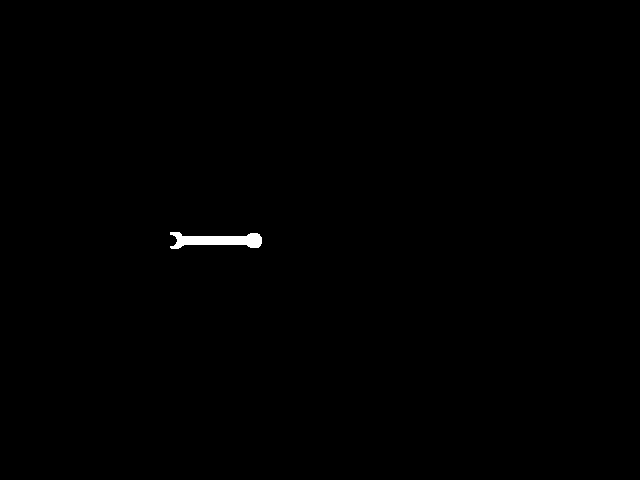
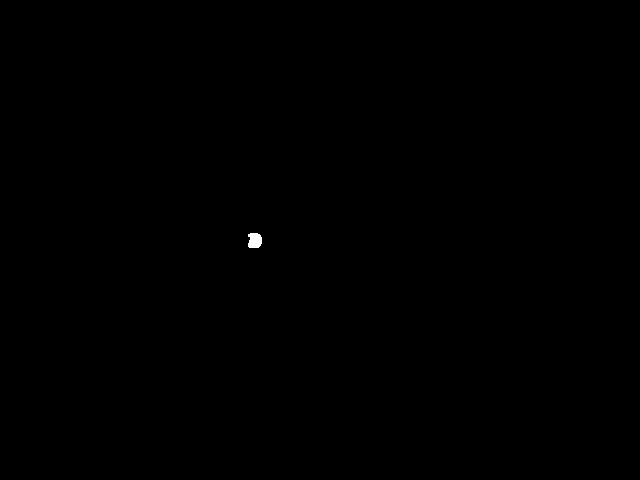
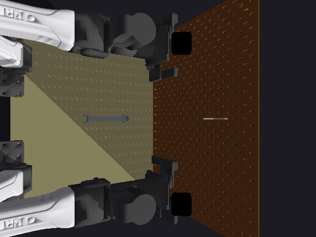
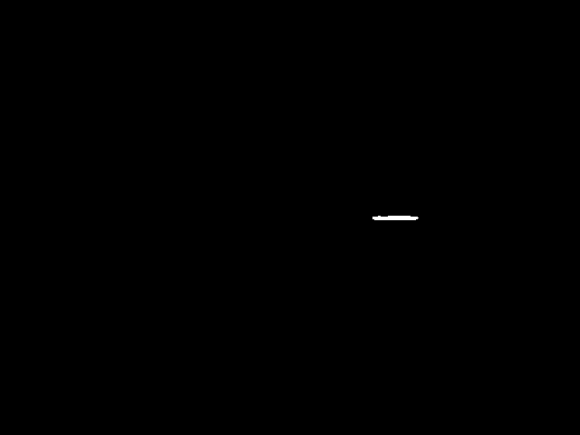
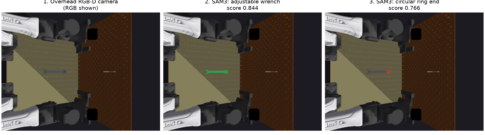
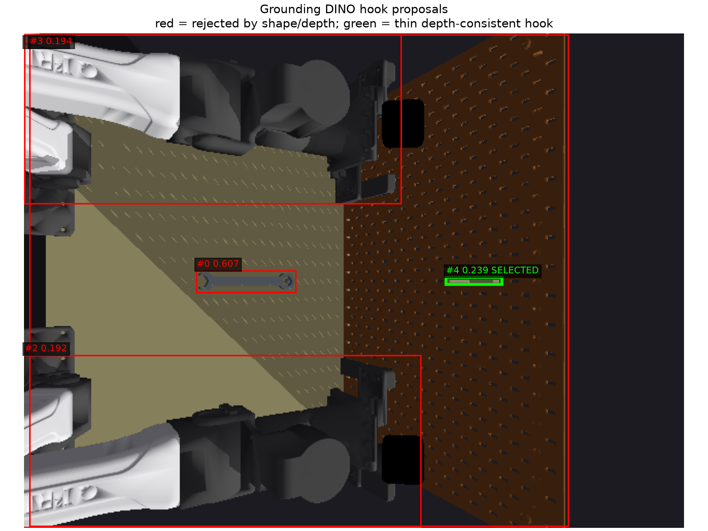
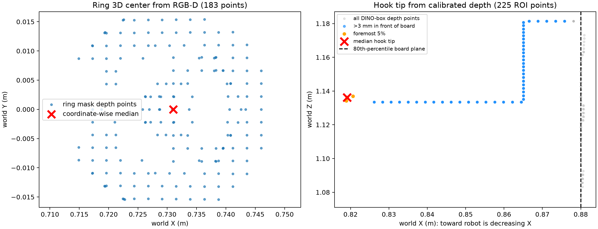
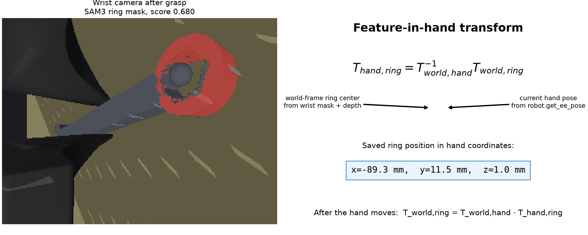

# Wrench perception artifacts

These files were copied from the successful `wrench_gap_perception_second`
rollout trace. They are real inputs and outputs recorded by GaP's tracing
system, not hand-drawn illustrations.

## 1. Whole wrench

Prompt: `adjustable wrench`


SAM3's highest-scoring whole-wrench result had score `0.84375` and bounding
box `(168.97, 232.14) - (262.39, 249.26)`.



The full typed response is in
[`02_sam3_wrench_response.json`](02_sam3_wrench_response.json).

## 2. Wrench ring

Prompt: `circular ring end of adjustable wrench`

SAM3's selected ring result had score `0.765625` and bounding box
`(246.81, 233.03) - (262.20, 248.07)`.



The full response is in
[`03_sam3_ring_response.json`](03_sam3_ring_response.json). The mask is then
back-projected through the RGB-D camera calibration to obtain the ring's
world-frame 3D center.

## 3. Wall hook

Prompt sent to Grounding DINO: `metal wall hook.`



Grounding DINO proposed five boxes. Its strongest box had score `0.60734` and
coordinates `(166.95, 230.04) - (263.21, 251.05)`. All raw proposals are in
[`05_grounding_dino_hook_detections.json`](05_grounding_dino_hook_detections.json).
The graph tests proposed boxes with SAM3 and depth geometry rather than simply
accepting the highest DINO score.



SAM3's response for this proposal is in
[`06_sam3_hook_response.json`](06_sam3_hook_response.json). The final hook tip
is recovered from RGB-D points in the selected region; it is not supplied by
simulator ground truth.

## Model ownership

- Grounding DINO and SAM3 are existing tool bundles from
  `open-robot-skills/tools`; their model implementations were not
  created for this task.
- `perceiving-objects` is an existing open skill from
  `open-robot-skills/skills/perceiving-objects`.
- The wrench ring prompt, hook-candidate filtering, RGB-D hook-tip heuristic,
  and feature-in-hand mapping are tool-hanging-specific scripts added under
  `graphs/gap_perception/scripts`. They compose existing model tools but are
  not themselves stock GaP perception skills.

## Detailed visual walkthrough

### A. Locate the wrench and its ring



The overhead camera supplies RGB, depth, intrinsics, and its calibrated world
pose. `sam3.segment_text` is first called with `adjustable wrench`; the graph
keeps its highest-scoring mask as the whole-tool mask. It calls the same stock
tool again with `circular ring end of adjustable wrench`. This phrase is our
task-specific prompt, not a newly trained model.

For every ring-mask pixel `(u,v)` with valid depth `d`, the existing
`geometry.mask_to_world_points` tool performs the usual calibrated
back-projection:

```text
p_camera = d * inverse(K) * [u, v, 1]
p_world  = T_world_camera * p_camera
ring_center_world = coordinate-wise median(all p_world)
```

The median is used instead of the mean to reduce the effect of stray depth
pixels. The exact 183 saved ring points are in
[`07_ring_points_world.npz`](07_ring_points_world.npz).

### B. Locate the thin hook



Grounding DINO receives `metal wall hook.` and proposes boxes. Importantly,
the largest DINO score is **not** trusted: proposal #0 is actually the wrench.
The graph applies these checks to each of the first eight proposals:

1. The 2D box must be elongated: its long/short side ratio must be at least
   `2.5`.
2. SAM3 segments inside that box; its best mask score must be at least `0.50`.
3. Every depth pixel inside the complete DINO box is back-projected to world
   coordinates.
4. The 80th percentile of world X estimates the pegboard's far plane.
5. Points at least 3 mm in front of that plane become the protruding-hook
   candidate.
6. The protrusion must contain at least 20 points and span at least 25 mm in X.
7. Among surviving candidates, choose the one associated with the dominant
   far-X board plane. In this rollout that is green proposal #4.

Thus DINO provides semantic proposals, SAM3 provides a mask-confidence check,
and calibrated depth decides which proposal has real hook-like 3D geometry.

### C. Calculate the ring center and hook tip from point clouds



Yes, this implementation uses point clouds. They are small, task-local point
sets generated from masks/boxes and the depth image rather than a global fused
scene reconstruction.

For the hook, the board is behind the hook in world X. After removing the
board-plane points, the graph takes the foremost 5% of the remaining points
and uses their median as the hook tip:

```text
board_x   = percentile(ROI_points.x, 80)
hook      = ROI_points where x < board_x - 3 mm
front     = hook where x <= percentile(hook.x, 5)
hook_tip  = median(front)
```

The saved DINO-box point set is
[`08_hook_roi_points_world.npz`](08_hook_roi_points_world.npz). This is a
geometric heuristic written for the known vertical-pegboard workcell; it is
not behavior learned by DINO or SAM3.

### D. Calculate `feature in hand` after grasping



After the gripper closes, the fixed `overhead` camera observes the wrench again.
SAM3 finds the ring, and its depth converts that mask into a world-frame ring center.
The robot independently reports its current end-effector pose. The graph then
stores the ring relative to the hand:

```text
T_hand_ring = inverse(T_world_hand) * T_world_ring
```

In this rollout the ring was approximately `[-89.3, 11.5, 1.0] mm` in the
hand frame. This relative transform remains constant while the rigid wrench
does not slip. After any hand motion, the expected ring position is recovered
with:

```text
T_world_ring = T_world_hand * T_hand_ring
```

That is how the placement planner controls the ring rather than mistakenly
controlling the gripper center. To put the ring at a desired point, it solves:

```text
p_world_hand_target = p_world_ring_target - R_world_hand_target * p_hand_ring
```

The wrist image, mask, 5,228-point RGB-D cloud, measured end-effector pose,
and resulting transform are all saved in files `09_...` through `11_...` in
this directory.

## What is model-based versus hand-written?

| Component | Origin | Role |
| --- | --- | --- |
| Grounding DINO | Existing open-robot-skills tool | Text-conditioned hook boxes |
| SAM3 | Existing open-robot-skills tool | Text/box-conditioned masks |
| RGB-D back-projection | Existing geometry tool | Mask pixels to world 3D points |
| `perceiving-objects` | Existing open skill | General object-perception ownership/contract |
| Ring text prompt | Added here | Names the wrench feature to segment |
| Hook filtering and tip rule | Added here | Selects a real protrusion and estimates its endpoint |
| Feature-in-hand transform | Added here | Preserves the ring-to-gripper spatial relationship |
| 190 mm lift and mating offsets | Added here | Task/robot motion parameters, not perception |

Run `uv run python generate_figures.py` from this directory to regenerate the
four explanatory PNG figures from the saved rollout artifacts.
